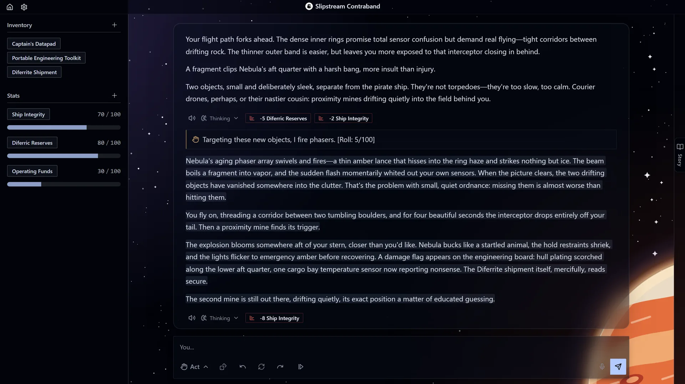
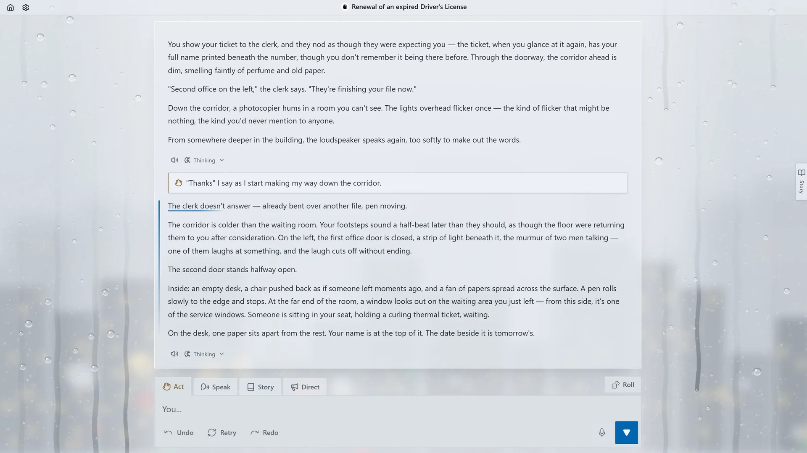
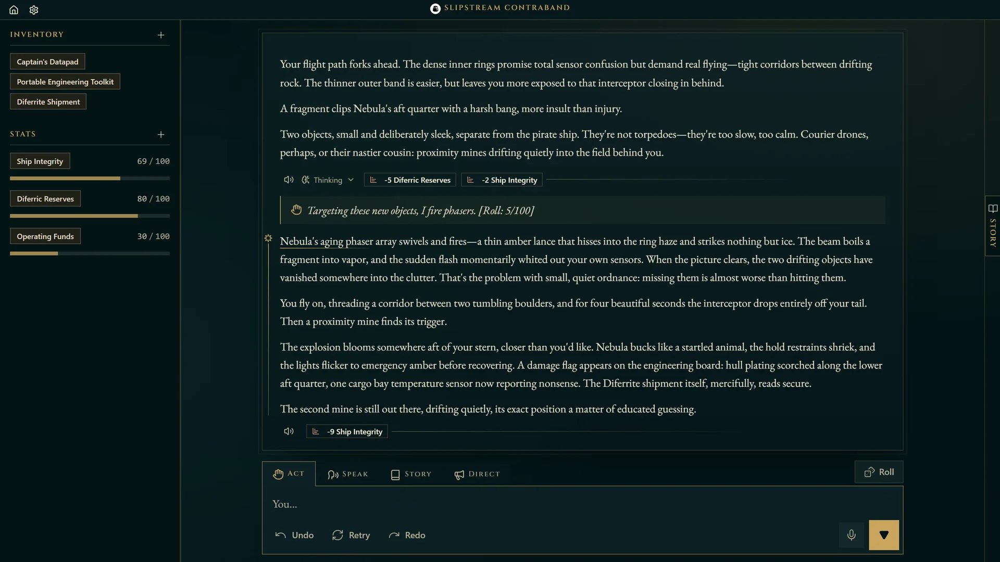

<h1 align="center">Hakawati</h1>

<p align="center">
  <a href="https://www.gnu.org/licenses/gpl-3.0"></a>
  <a href="https://github.com/rakanssh/hakawati/releases/latest"></a>
  <a href="https://github.com/rakanssh/hakawati/releases"></a>
</p>



Hakawati is a free and open-source AI text adventure for Windows, macOS, Linux,
Android, and iOS. It works with a ChatGPT plan, an API key from a provider, or a
model running on your own computer.

Your tales and scenarios are saved on your device, and you don't need an account
to play. With one, you can sync tales between devices and publish scenarios.

[Download](https://github.com/rakanssh/hakawati/releases/latest) ·
[Website](https://hakawati.dev) · [Changelog](CHANGELOG.md) ·
[Report a bug](https://github.com/rakanssh/hakawati/issues)

- [Game modes](#game-modes)
- [Getting started](#getting-started)
- [Tales and scenarios](#tales-and-scenarios)
- [Hakawati assistant](#hakawati-assistant)
- [Accounts and cloud](#accounts-and-cloud)
- [Development](#development)
- [Support and license](#support-and-license)

## Game modes

### Story Teller

The AI narrates whatever you do, say, or direct. There's no inventory or stats
to keep track of.



### Game Master

The AI narrates and also keeps your character's inventory and stats up to date.
This mode is experimental. It needs a model that supports tool calling, and some
models handle it much better than others.



## Getting started

1. Install the [latest release](https://github.com/rakanssh/hakawati/releases/latest)
   for your system.
2. Open **Settings → AI Setup**, choose **Add a connection**, and pick a
   provider. Enter an API key if it asks for one. For a model on your own
   computer, pick **Local**. Hakawati looks for a running server, or you can
   enter its address.
3. Choose a **Narrator** model. The **Helper**, which writes generated
   scenarios, story cards, and summaries, uses the Narrator's model unless you
   pick another.
4. Press **Quickstart** on Home to have a tale made for you, or open a scenario
   and press **Start Tale**.

Hakawati doesn't come with a model or API credits. Your requests go to the
provider or local server you set up. There are presets for OpenRouter, OpenAI,
and NanoGPT, and **Another provider** takes any OpenAI-compatible address. For
LM Studio, Ollama, LocalAI, and similar tools, start the model server before
you connect.

Each turn, pick how your input is read: **Act**, **Say**, **Story**, or
**Direct**. **Continue** has the narrator carry on without you. You can edit any
passage, retry a reply, and undo or redo turns. Tales save as you play and show
up under **Tales**.

To talk instead of typing, or to hear the story read aloud, set up **Speech to
Text** and **Text to Speech** in AI Setup. Language, themes, and reading
settings are under **Appearance**.

### Using a ChatGPT plan

Add a **ChatGPT plan** connection and press **Continue with ChatGPT** to sign
in. Hakawati then runs on your plan instead of API credits. You can check your
usage and limits in the ChatGPT app.

## Tales and scenarios

A tale is one adventure in progress. A scenario is a starting point you can
reuse for as many tales as you like, with an opening, a world, and a starting
character.

In **Scenarios** you can **Create** a scenario, **Generate** one, or **Import**
one from the clipboard. **Export JSON** in a scenario's menu copies it to the
clipboard so you can share it.

### Editing a scenario

Everything in the editor, including the name, description, and cover, is saved
as one draft.

| Field                                    | What it's for                                                                                                  |
| ---------------------------------------- | -------------------------------------------------------------------------------------------------------------- |
| Name, description, and cover             | How the scenario looks in your library and the public catalog. The AI never sees the description.              |
| AI Instructions, Plot, and Author's Note | What the narrator is told to follow and keep in mind.                                                          |
| Opening Text                             | The first passage of every new tale.                                                                           |
| Game mode                                | Story Teller or Game Master.                                                                                   |
| Stats and inventory                      | Where the character starts in Game Master mode.                                                                |
| Story cards                              | Notes on characters, places, and things. The AI gets a card when its triggers match, or always if it's pinned. |

**Save draft** keeps your changes on your device. **Publish**, or **Publish
update** for a scenario you've published before, shows a preview of the name,
description, and cover, then publishes the whole draft with the tags you pick.
Edits after that stay in the draft until you publish again. Hakawati shrinks
covers before uploading them.

Every tale gets its own copy of the scenario, so editing a scenario never
changes tales you've already started. While you play, the story panel on the
right has tabs for **Hakawati**, the tale's **Story** and **Cards**, the
**Character** in Game Master mode, the **AI** model, and **Display** settings.

### Scenario questions

A scenario can ask for a name, a background, or anything else before the tale
starts:

```text
Your name is ${What is your name?}.
Your ship is ${What is your ship's name? | options: The Skipper, Nebula}.
```

The answers fill in the placeholders in the new tale. A question that appears
twice is only asked once, and the scenario itself stays as it was. Placeholders
are plain text, not scripts. [Scenario questions](SCENARIO_QUESTIONS.md) covers
the supported fields, fixed choices, and escaping.

## Hakawati assistant

The app has a built-in assistant, also called Hakawati, that can do most things
in the app for you. Open it with the Hakawati button or **Ctrl+K** (**⌘K** on
macOS) and ask in plain words. On a phone the button sits at the bottom of the
screen, and in a tale Hakawati is a tab in the story panel.

Ask it about your tales and scenarios, or have it:

- edit a tale's setup, story cards, character, or passages
- write a scenario, or turn a tale into one
- start or open a tale
- change settings or the models in AI Setup
- delete, sync, or export tales and scenarios
- search Discover and manage the scenarios you've published

It won't play your turns for you.

Each reply lists what Hakawati changed, and **Undo** puts it back without losing
anything you've edited since. Before it deletes something, removes it from the
cloud, overwrites one side of a sync conflict, or unpublishes a scenario, it
asks you with buttons in the chat. API keys, server addresses, signing in, and
publishing stay with you. For those, it opens the right screen and tells you
where to click.

Long jobs pause with a **Continue** button. **Retry** undoes the last reply's
changes and runs it again. You can talk to Hakawati with **Speech to Text** and
attach up to four images to a message.

Hakawati runs on your Narrator model unless you give it its own in **Settings →
AI Setup**, and that model has to support tool calling. Each tale keeps its own
chats.

## Accounts and cloud

You don't need a Hakawati account to play or to make scenarios. You can also
browse public scenarios in **Discover** and start tales from them without
signing in.

An account adds tale sync and scenario publishing. Sign in and manage sync under
**Settings → Account & Sync**.

- Choose which of your existing tales to sync. The rest stay on your device.
- Once sync is on, new tales sync too. To keep one on your device only, use
  **Start Local** on a scenario or turn on **Keep this tale local only** in
  Quickstart.
- **Remove from cloud** deletes the cloud copy and keeps the one on your device.
- If a tale changes on two devices, you can look at both versions and choose
  which to keep.
- Published scenarios are public and moderated. A tale you start from one is
  your own copy, so later changes to the scenario don't touch it.

A Hakawati account doesn't include any AI, so you still need a provider. The
[Privacy Policy](https://hakawati.dev/privacy),
[Terms of Service](https://hakawati.dev/terms), and
[Community Guidelines](https://hakawati.dev/community-guidelines) cover the
hosted services.

## Development

### Prerequisites

- Node.js 22.12 or newer and npm.
- The stable Rust toolchain and the platform dependencies in
  [Tauri's prerequisites](https://v2.tauri.app/start/prerequisites/).
- [`cargo-about`](https://github.com/EmbarkStudios/cargo-about) for bundled license
  notices.

### Run the desktop app

```sh
git clone https://github.com/rakanssh/hakawati.git
cd hakawati
npm ci
cargo install cargo-about --locked
npm run licenses:generate
npm run tauri dev
```

To use the hosted services from a development or local build, add this to
`.env.local`:

```dotenv
VITE_HAKAWATI_SYNC_SERVER_URL=https://api.hakawati.net
```

It's the public address of the cloud service, not an AI provider or a secret.
Leave it out if you don't need sync or publishing. Release builds get it from
the GitHub `production` environment.

### Build locally

```sh
npm run tauri -- build --config src-tauri/tauri.test.conf.json -- --locked
```

This config skips the updater files, which need the release signing key. The
build makes the frontend and license notices, then puts the executable in
`src-tauri/target/release/` and the installers in
`src-tauri/target/release/bundle/`.

Tagged releases are signed by [the release workflow](.github/workflows/release.yml).

### Run on Android

Install the Android SDK and NDK and a JDK from 17 to 24 (Gradle 8.14 doesn't run
on JDK 25), and set `ANDROID_HOME`, `NDK_HOME`, and `JAVA_HOME` as described in
[Tauri's prerequisites](https://v2.tauri.app/start/prerequisites/). Then, with a
device or emulator connected:

```sh
npm run tauri -- android dev
```

Release builds are signed with the keystore in
`src-tauri/gen/android/keystore.properties` (`storeFile`, `storePassword`,
`keyAlias`, and `keyPassword`; kept out of git) or in the `HAKAWATI_KEYSTORE_FILE`,
`HAKAWATI_KEYSTORE_PASSWORD`, `HAKAWATI_KEY_ALIAS`, and `HAKAWATI_KEY_PASSWORD`
environment variables. Without either, the build is unsigned.

```sh
npm run tauri -- android build --apk
```

### Run on iOS

On a Mac, install Xcode and the iOS Rust targets as described in
[Tauri's prerequisites](https://v2.tauri.app/start/prerequisites/). Release
builds with Xcode 27 also need `rustup component add llvm-tools`. Then run on a
simulator or a connected device:

```sh
npm run tauri -- ios dev "iPhone 17 Pro"
```

The app's own Swift code, for dictation and the sign-in sheet, is in
`src-tauri/ios/Plugins` and is built by `src-tauri/build.rs`.

### Browser preview

```sh
npm run dev:browser
```

Then open [http://127.0.0.1:1422](http://127.0.0.1:1422). The preview runs the
UI on sample tales and scenarios in an in-memory SQLite database, with scripted
narration. Reloading resets the samples.

There's no model behind the preview's Hakawati. It runs the tools you name in
your message, one `/tool name {"arg":"value"}` line per call. A `/loop` line
repeats them every step, and `/cutoff` stops each step after the first tool
results.

The preview doesn't need Rust, an account, or an API key, and it can't see your
desktop saves. AI calls, cloud features, audio, and updates don't work in it.

### Checks

```sh
npm run typecheck
npm run lint
npm run format
npm run i18n:check
npm run test:run
npm run build
cargo test --locked --manifest-path src-tauri/Cargo.toml
```

The app is built with Tauri 2, React 19, TypeScript, Vite, Tailwind CSS,
shadcn/ui, TanStack Router, and Zustand, and keeps tales and scenarios in
SQLite.

## Support and license

Report bugs and request features in
[GitHub Issues](https://github.com/rakanssh/hakawati/issues). For your account,
privacy, or anything else, email [support@hakawati.net](mailto:support@hakawati.net).

Hakawati is licensed under the [GNU GPL v3.0 or later](LICENSE).
Desktop builds include third-party license notices in `LICENSES/`, and
`npm run licenses:generate` regenerates them.

© 2025–2026 Rakan AlShammari
